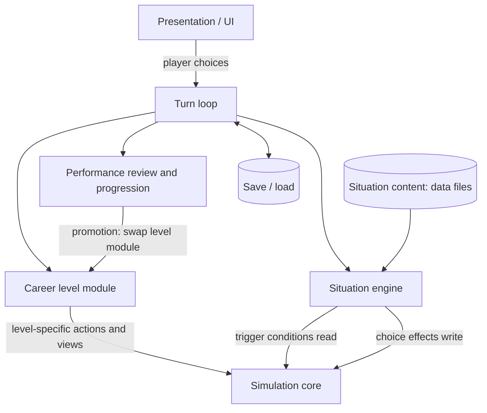

# High-Level Design: Manager Simulator

## Problem

Engineering management is a career most engineers enter without a clear picture of what the job is, and the job changes shape at every level. A line manager's work is about individual people; a senior manager's work is about other managers; a director's work is about organizations, budgets and strategy. Few games treat management as a craft, and those that touch it (tycoon and business sims) flatten it into resource allocation. There is room for a game whose core fantasy is the climb itself: getting good at one version of the job, getting promoted, and discovering that the skills that got you there are not the ones you now need. Played well, such a game is also practice: a safe place to make management mistakes, see their consequences, and learn what works better.

## Approach

### A simulated organization with authored situations on top

A lightweight simulation models the organization the player manages: people (skill, motivation, stress, what they want from the job, trust in their manager, and a history of what happened to them), teams, projects (scope, risk, tech debt, deadlines) and the player's own standing (reputation with their boss, stress). The simulation produces the *state*; authored **situations** produce the *drama*. A situation is a piece of written content — a 1:1 conversation, an escalation, an incident, a calibration meeting — with trigger conditions evaluated against simulation state, a set of choices, and effects that write back into the simulation. A flight-risk conversation appears because that engineer's motivation actually fell; the player's choice in it changes what the simulation does next.

### A week is a run of moments

A turn is not a planning screen. A week plays as a short sequence of **moments**: a standup, someone at your desk, a 2 a.m. page, a stakeholder email, a Friday 1:1. Each moment is a small scene with a few choices, and every choice gets an **immediate reaction**, written in the voice of the people involved, with its effects shown at once. The people the player manages are **characters**. Each has a personality that colours how they react, and a memory of what happened between you, which later moments bring up. Routine work does not need a decision each time: the player sets a few standing **habits** for how they run the team (who takes the night pages, whether Fridays are kept for 1:1s, who signs routine approvals), and only interesting work becomes a moment. Each week ends with a **recap** of what changed and why, and each review period has a few **goals** from the player's own manager to aim at. Habits and goals are the player's proactive levers; moments are where they meet what the week brings.

### Each career level is a different game

The game is divided into **career levels**, and each level is its own set of mechanics, not a wider view of the same ones:

| Level | You manage | Time step | What the player handles directly |
|---|---|---|---|
| Line manager | Individual engineers (one team) | Week | 1:1s and feedback, evaluations and self-evaluations, promotion cases and arguing ratings in calibration, training, performance improvement plans and the terminations that follow failed ones, conflicts, interviewing and onboarding (including interns, entry-level program engineers, contractors and remote workers), leave, travel, expense and conference approvals, team events, agile ceremonies, work intake, project management and product ownership (backlog priority, scope and stakeholders), deliverables and due dates, incidents and on-call escalations, release and access approvals, architecture and design reviews, customer interaction |
| Senior manager | Line managers (several teams) | Month | Delegating to and coaching managers, running calibrations and balancing ratings across teams, approving promotions and terminations, reassignments and restructuring, staffing across teams, cross-team dependencies and scrum-of-scrums, cross-team design disputes, customer escalations, referrals and external feedback requests |
| Director and above | Senior managers (an organization) | Quarter | Headcount budget, org design, seating and space, strategy bets, executive politics and presentations, culture, diversity and belonging, volunteering and specialty groups, marketing the organization |

Director and above spans several career levels (for example Director and VP), each its own level module; how they divide is defined in that level's design.

Some responsibilities recur at several levels but change shape with the role: a line manager writes promotion cases and argues ratings, a senior manager runs the calibration that weighs them; a line manager interviews, a senior manager staffs teams, a director sets headcount. Presentations exist as a mechanic only at director and above, where presenting to executives is part of the job; below that they appear only as situations (a demo, a status update).

On promotion, mechanics from the previous level are retired or folded into aggregates (a team becomes a few health numbers owned by its manager), and new mechanics appear. The simulation underneath keeps running at whatever level of detail the current level needs; the player sees only what someone in that role would see.

### Drawn from real management work

Situations and actions come from the recurring responsibilities of engineering managers: people work (hiring, onboarding, evaluations, calibrations, promotions, improvement plans, terminations, leave, conflicts), delivery (work intake, project management and product ownership, ceremonies, deliverables and due dates), operations (incident escalations, release and access approvals, legacy support, resiliency upkeep), administration (travel, expenses, conference approvals) and culture (team events, belonging, volunteering). The original list this draws on is in [references/2023-idea-notes.md](references/2023-idea-notes.md).

At the line manager level, hands-on operational and technical-lead duties (approvals, design reviews, customer requests, legacy support, data investigations, on-call) compete with managing people for the player's time and energy, rather than appearing as technical puzzles. Habits handle the routine ones, and the rest arrive as moments. Learning which to keep, which to delegate and to whom is one of the level's lessons.

### Progression and failure

Every person the player manages has a **performance level**, a rating distinct from their skill that evaluations set and calibrations argue over. The player has a **scorecard** of manager KPIs for their current level (for a line manager, say, delivery, retention and team health; for a director, budget, attrition and strategic outcomes). The player advances through periodic performance reviews that read their scorecard. A run can end through promotion past the top level, through being managed out, through burnout, or by reaching a level's last review without a promotion: each level lasts a few years at most, as a real role does before a manager moves up or settles where they are.

## Target Users

- **Engineers and engineering managers** who will recognize the situations and enjoy seeing them played out, including the absurd ones.
- **Players of management and narrative sims** who want a game with sharp choices and visible consequences, and who do not need to know the industry.

- **Aspiring and new managers** who want to practice the job: to try approaches, fail safely, and learn which choices tend to work better.

All of them need a game that is fun to play in sessions of 20–60 minutes, with no domain knowledge required to start.

## Goals

- Each promotion feels like starting a new job: a player can name at least one thing they used to do that they no longer do, and one new thing they have to learn.
- Consequences are traceable: when something goes wrong, the player can see which earlier decisions or neglected people led to it.
- Choices feel consequential: every choice gets a reaction at once, and people bring past choices up later.
- A full run from line manager to the top level is completable in a few hours of play.
- New situations can be added as content (data) without changing simulation code.
- Skill is learnable: situations have better and worse choices, the better choices reflect sound management practice, and a player who learns from earlier runs does measurably better in later ones.

## Non-Goals

- **No lessons or quizzes outside play.** The game teaches through consequences in play and through debriefs that explain why a choice or turn went the way it did; it has no standalone lessons or graded tests, and makes no claim that its outcomes predict real-world outcomes. The start screen tells the player so: the game is fiction, simplified for play, and not advice for real decisions about real people. Explaining how to play, in a help panel or in onboarding during the first weeks, is not a lesson in this sense: it teaches the game's controls, not management.
- **No individual-contributor work.** The player never writes code or solves technical puzzles; technical work exists only as simulated output.
- **No realistic HR, legal or compensation processes.** These appear only as situations, abstracted for pace.
- **No multiplayer, no online services.** The game runs locally.

## Tenets

- **Fun over authenticity in pace and process.** When realism and fun pull apart over timing, procedure or presentation (a realistically slow hiring cycle, a tedious but true process), choose the version that plays better; cause and effect between management choices and their outcomes stays true to real practice.
- **Learnable over ambiguous.** When a situation could be written as a pure trade-off or with a choice that is clearly better for a skilled player, give it a better choice, and make that choice reflect sound management practice.
- **Show it through people over through numbers.** When an effect could be shown as a person's words and reactions or as a changed number, lead with the person; numbers stay available as secondary detail for players who want them.
- **A fresh role over a continuous system.** When a mechanic could carry over to the next level or be replaced by one that fits the new role better, replace it, even at the cost of the player relearning.

## System Design

- **Simulation core**: the organization model (people, teams, projects, the player's standing) and the rules that advance it one time step. Deterministic for a given seed and sequence of player choices. Has no UI and no knowledge of which career level is active beyond the level of detail it is asked to simulate.
- **Career level modules**: one per level. Each defines the player's habits and other actions, the time step, what is visible versus aggregated, and the review criteria. Promotion replaces the active module and converts simulation state into the next level's level of detail.
- **Situation engine**: evaluates authored situations against simulation state, selects which ones fire each turn and where in the week they fall, presents their choices, and applies effects and reactions.
- **Situation content**: authored situations as data files, each tagged with the career levels it belongs to.
- **Turn loop**: plays each turn as a run of moments, then the simulation advance and a recap, then a review when due.
- **Performance review and progression**: scores the player against the active level's criteria and decides promotion, continued play, or the end of the run.
- **Presentation / UI**: renders the active level's views and situations and collects choices.
- **Save / load**: persists a run locally.

## Key Design Decisions

- **The week as a run of moments.** The player spends a turn in short scenes that react to every choice, with characters who remember, standing habits instead of per-item planning, and a recap. A planning screen of calendar and inbox plays correctly but reads as a test. Chosen over keeping the planner with more feedback and over a relationships-only game; see [decisions/moments-loop.md](decisions/moments-loop.md).
- **Hybrid of simulation and authored situations.** Writing is the source of drama and of the lessons; simulated state decides when and why situations appear, so the same situation lands differently across runs. Chosen over a pure narrative decision game and a pure systemic simulation; see [decisions/simulation-and-situations.md](decisions/simulation-and-situations.md).
- **Separate mechanics per career level.** One shared mechanic set with a widening scope would be simpler to build and keep players' skills relevant, but it would not deliver the core fantasy that each level is a different job. Level modules over a shared simulation core keep the per-level mechanics separate without needing three separate simulations.
- **The senior manager acts through managers.** The player's people at the second level are line managers, full characters with a management skill, each leading a team seen only as an aggregate; the player never acts on an engineer directly, and staffing and cross-team decisions arrive as moments. Chosen over an allocation board of teams and over a player-coach who keeps leading the old team; see [decisions/senior-manager-shape.md](decisions/senior-manager-shape.md).
- **The director runs an organization through senior managers and quarterly bets.** The player's people at the third level are senior managers, full characters, each leading a group seen only as an aggregate of teams; the level's main levers are a headcount budget, strategy bets that pay off or fail over later quarters, and a quarterly review presented to the player's executives, with the player's boss and peers as characters. Chosen over a game of executive politics in which the organization fades into numbers, and over a portfolio board; see [decisions/director-shape.md](decisions/director-shape.md).
- **Time step widens with level.** Weeks, months, then quarters, so that a run at each level takes a similar amount of play time while the player's horizon grows the way it does in the real role.
- **TypeScript, played in the browser first.** Runs locally in a browser with no install and no server, which suits short sessions and easy sharing for playtests. A desktop or engine-based build is not worth the packaging work yet for a text- and UI-driven game.
- **Players count weeks from 1.** The simulation counts game weeks from 0, which keeps its arithmetic simple; every week number the player reads (the header, recaps, deadlines, goals, reviews) shows game week *w* as week *w* + 1, so a run starts in week 1 as a player expects. Saves and content conditions use game weeks.
- **Deterministic simulation core.** Seeded randomness makes runs reproducible, which allows tests of balance and of situation triggers, and makes bugs reproducible.
- **Situations as data.** Content grows faster than code; keeping situations in data files lets content be written and tuned without touching the simulation.

## Success Metrics

- Playtesters complete at least one promotion in their first session.
- Playtesters asked "what changed when you were promoted?" name concrete mechanics, not only bigger numbers. *Falsification signal:* if players describe higher levels as "the same thing with more people," the per-level design has failed.
- Playtesters can explain at least one bad outcome by pointing to an earlier decision.
- Playtesters describe a session as playing a game. *Falsification signal:* if they describe it as answering questions or taking a test, the moments loop has failed.
- Across seeded test runs, choices that follow sound practice outperform naive ones, and no context-blind strategy (always agree, always push back) reliably wins every level.

## References

- [Original idea notes (2023)](references/2023-idea-notes.md): the responsibilities list this design draws its situations and mechanics from.

- Management sims and narrative decision games are the nearest genres. This project borrows from their structure, not from any specific game's content.
