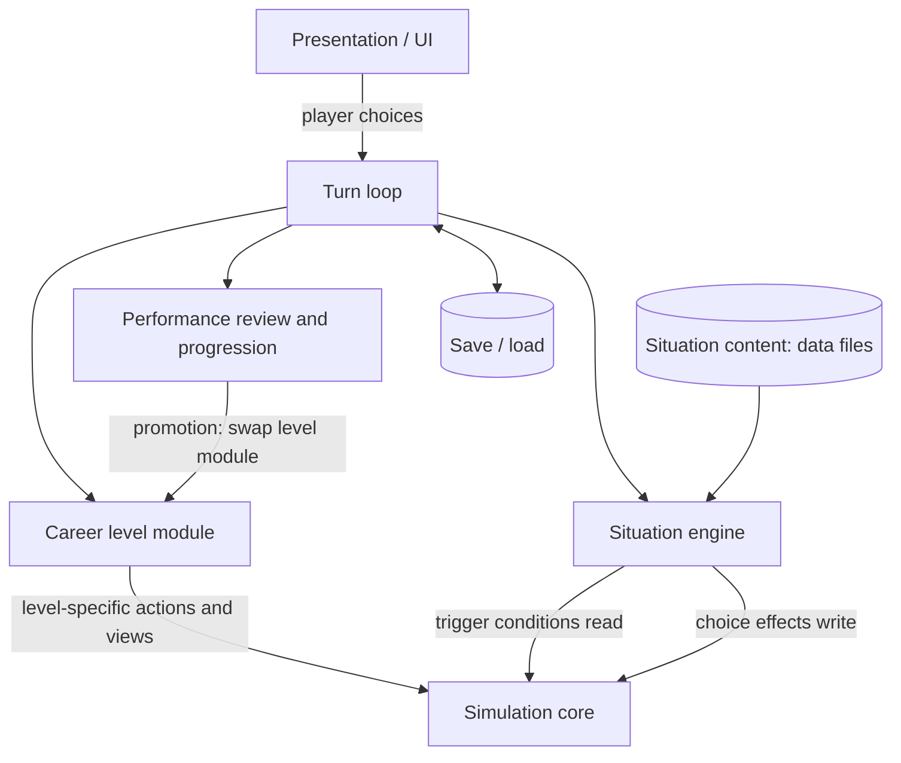

# High-Level Design: Manager Simulator

## Problem

Engineering management is a career most engineers enter without a clear picture of what the job is, and the job changes shape at every level. A line manager's work is about individual people; a senior manager's work is about other managers; a director's work is about organizations, budgets and strategy. Few games treat management as a craft, and those that touch it (tycoon and business sims) flatten it into resource allocation. There is room for a game whose core fantasy is the climb itself: getting good at one version of the job, getting promoted, and discovering that the skills that got you there are not the ones you now need. Played well, such a game is also practice: a safe place to make management mistakes, see their consequences, and learn what works better.

## Approach

### A simulated organization with authored situations on top

A lightweight simulation models the organization the player manages: people (skills, motivation, career goals, relationships), teams, projects (scope, risk, tech debt, deadlines) and the player's own standing (reputation with their boss, stress). The simulation produces the *state*; authored **situations** produce the *drama*. A situation is a piece of written content — a 1:1 conversation, an escalation, an incident, a calibration meeting — with trigger conditions evaluated against simulation state, a set of choices, and effects that write back into the simulation. A flight-risk conversation appears because that engineer's motivation actually fell; the player's choice in it changes what the simulation does next.

### Each career level is a different game

The game is divided into **career levels**, and each level is its own set of mechanics, not a wider view of the same ones:

| Level | You manage | Time step | What the player handles directly |
|---|---|---|---|
| Line manager | Individual engineers (one team) | Week | 1:1s, feedback, hiring, sprint/project delivery, incidents |
| Senior manager | Line managers (several teams) | Month | Delegation, coaching managers, cross-team dependencies, calibration, staffing |
| Director and above | Senior managers (an organization) | Quarter | Headcount budget, org design, strategy bets, executive politics, culture |

Director and above spans several career levels (for example Director and VP), each its own level module; how they divide is defined in that level's design.

On promotion, mechanics from the previous level are retired or folded into aggregates (a team becomes a few health numbers owned by its manager), and new mechanics appear. The simulation underneath keeps running at whatever level of detail the current level needs; the player sees only what someone in that role would see.

### Progression and failure

The player advances through periodic performance reviews whose outcome depends on how the organization they are responsible for is doing, measured in the terms that matter at their level. A run can end through promotion past the top level, through being managed out, or through burnout.

## Target Users

- **Engineers and engineering managers** who will recognize the situations and enjoy seeing them played out, including the absurd ones.
- **Players of management and narrative sims** who want a game with sharp choices and visible consequences, and who do not need to know the industry.

- **Aspiring and new managers** who want to practice the job: to try approaches, fail safely, and learn which choices tend to work better.

All of them need a game that is fun to play in sessions of 20–60 minutes, with no domain knowledge required to start.

## Goals

- Each promotion feels like starting a new job: a player can name at least one thing they used to do that they no longer do, and one new thing they have to learn.
- Consequences are traceable: when something goes wrong, the player can see which earlier decisions or neglected people led to it.
- A full run from line manager to the top level is completable in a few hours of play.
- New situations can be added as content (data) without changing simulation code.
- Skill is learnable: situations have better and worse choices, the better choices reflect sound management practice, and a player who learns from earlier runs does measurably better in later ones.

## Non-Goals

- **No lessons or quizzes outside play.** The game teaches through consequences in play and through debriefs that explain why a choice or turn went the way it did; it has no standalone lessons or graded tests, and makes no claim that its outcomes predict real-world outcomes.
- **No individual-contributor work.** The player never writes code or solves technical puzzles; technical work exists only as simulated output.
- **No realistic HR, legal or compensation processes.** These appear only as situations, abstracted for pace.
- **No multiplayer, no online services.** The game runs locally.

## Tenets

- **Fun over authenticity in pace and process.** When realism and fun pull apart over timing, procedure or presentation (a realistically slow hiring cycle, a tedious but true process), choose the version that plays better; cause and effect between management choices and their outcomes stays true to real practice.
- **Learnable over ambiguous.** When a situation could be written as a pure trade-off or with a choice that is clearly better for a skilled player, give it a better choice, and make that choice reflect sound management practice.
- **A fresh role over a continuous system.** When a mechanic could carry over to the next level or be replaced by one that fits the new role better, replace it, even at the cost of the player relearning.

## System Design

- **Simulation core**: the organization model (people, teams, projects, the player's standing) and the rules that advance it one time step. Deterministic for a given seed and sequence of player choices. Has no UI and no knowledge of which career level is active beyond the level of detail it is asked to simulate.
- **Career level modules**: one per level. Each defines the player's available actions, the time step, what is visible versus aggregated, and the review criteria. Promotion replaces the active module and converts simulation state into the next level's level of detail.
- **Situation engine**: evaluates authored situations against simulation state, selects which ones fire each turn, presents their choices, and applies effects.
- **Situation content**: authored situations as data files, each tagged with the career levels it belongs to.
- **Turn loop**: orders each turn: player actions, situations, simulation advance, review when due.
- **Performance review and progression**: scores the player against the active level's criteria and decides promotion, continued play, or the end of the run.
- **Presentation / UI**: renders the active level's views and situations and collects choices.
- **Save / load**: persists a run locally.

## Key Design Decisions

- **Hybrid of simulation and authored situations.** Writing is the source of drama and of the lessons; simulated state decides when and why situations appear, so the same situation lands differently across runs. Chosen over a pure narrative decision game and a pure systemic simulation; see [decisions/simulation-and-situations.md](decisions/simulation-and-situations.md).
- **Separate mechanics per career level.** One shared mechanic set with a widening scope would be simpler to build and keep players' skills relevant, but it would not deliver the core fantasy that each level is a different job. Level modules over a shared simulation core keep the per-level mechanics separate without needing three separate simulations.
- **Time step widens with level.** Weeks, months, then quarters, so that a run at each level takes a similar amount of play time while the player's horizon grows the way it does in the real role.
- **Browser game in TypeScript.** Runs locally in a browser with no install and no server, which suits short sessions and easy sharing for playtests. A desktop or engine-based build would add packaging work with no benefit for a text- and UI-driven game.
- **Deterministic simulation core.** Seeded randomness makes runs reproducible, which allows tests of balance and of situation triggers, and makes bugs reproducible.
- **Situations as data.** Content grows faster than code; keeping situations in data files lets content be written and tuned without touching the simulation.

## Success Metrics

- Playtesters complete at least one promotion in their first session.
- Playtesters asked "what changed when you were promoted?" name concrete mechanics, not only bigger numbers. *Falsification signal:* if players describe higher levels as "the same thing with more people," the per-level design has failed.
- Playtesters can explain at least one bad outcome by pointing to an earlier decision.
- Across seeded test runs, choices that follow sound practice outperform naive ones, and no context-blind strategy (always agree, always push back) reliably wins every level.

## References

- Management sims and narrative decision games are the nearest genres. This project borrows from their structure, not from any specific game's content.
